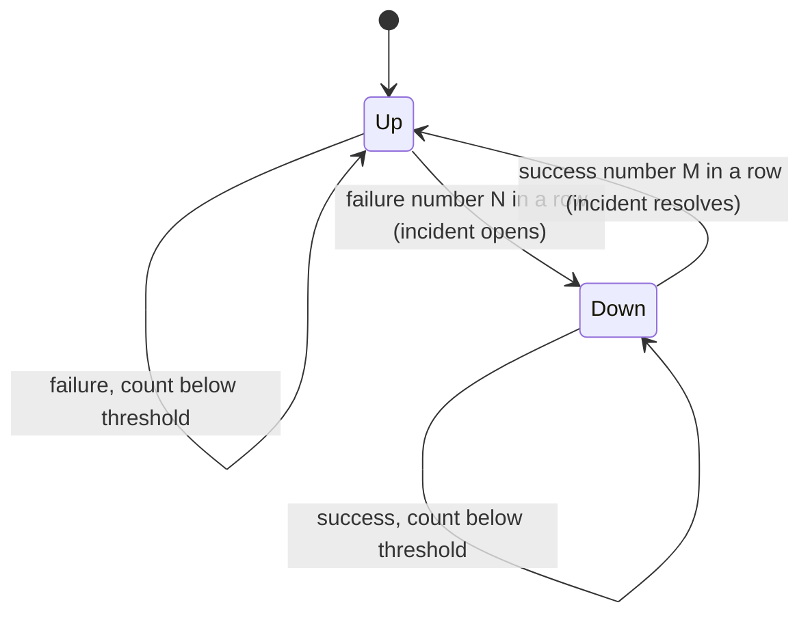

# uptime-lite

Self-hosted uptime monitor with debounced incident detection and a static public status page.

Status: early. The config loader, the check functions, the incident state machine and the SQLite history exist and are tested. There is no scheduler, so nothing runs on its own yet, and nothing is usable as a monitor today.

## Config

Checks are defined in YAML and validated up front. Every problem found is reported at once and names the check and the field, for example `check 'db' (checks[1]): field 'target': expected host:port, got 'not-a-target'`.

```yaml
checks:
  - name: example-website
    type: http
    target: https://example.com/
    interval: 60            # seconds between checks
    timeout: 10             # seconds, must not exceed interval
    failure_threshold: 3    # consecutive failures before an incident opens
    recovery_threshold: 2   # consecutive successes before it resolves
    expected_status: [200]  # optional, default is any 2xx

  - name: example-database
    type: tcp
    target: 192.0.2.10:5432
    interval: 60
    timeout: 3
```

`name`, `type` and `target` are required. The rest default to an interval of 60 s, a timeout of 10 s, a failure threshold of 3 and a recovery threshold of 2. The full example is in [examples/config.example.yaml](examples/config.example.yaml); its targets are placeholders (`example.com` and the RFC 5737 documentation ranges).

## How the debounce works

A single failed request is usually noise, so a check does not go down on the first failure. It goes down after `failure_threshold` failures in a row and comes back after `recovery_threshold` successes in a row. A result of the opposite kind resets the streak, so a check that flaps between failing and passing never reaches either threshold and produces no alerts.



The logic is a pure function in [src/uptime_lite/incidents.py](src/uptime_lite/incidents.py): no I/O, and the timestamp of each result is passed in. Results timestamped before the last applied one are ignored, so a slow check that finishes late cannot reopen or close an incident. The state is stored in SQLite after each result, so a restart continues the current streak or incident instead of starting over.

## What is not built yet

- The scheduler loop that runs checks on their intervals
- Telegram and webhook alerts
- The generated static status page
- Docker files and a CLI entry point

## Development

Requires Python 3.11 or newer.

```bash
python -m venv .venv
.venv/Scripts/activate        # Windows; on Linux/macOS: source .venv/bin/activate
pip install -e ".[dev]"
pre-commit install
```

Run the tests (coverage must stay at or above 85%):

```bash
pytest
```

Lint and type checks:

```bash
ruff check .
ruff format --check .
mypy
```

## License

MIT, see [LICENSE](LICENSE).
