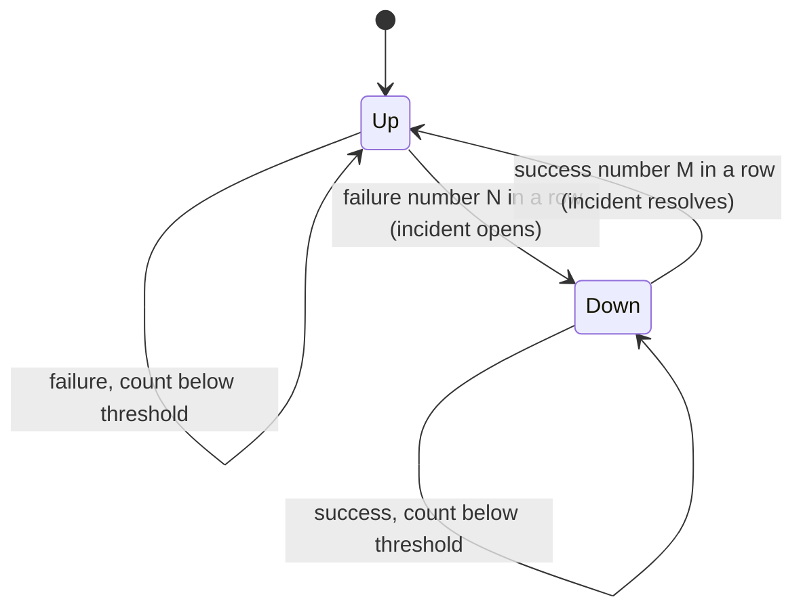

# uptime-lite

Self-hosted uptime monitor with debounced incident detection and a static public status page.

Site: [mohamedtaqysalmi.github.io/uptime-lite](https://mohamedtaqysalmi.github.io/uptime-lite/)

I built this for small deployments where one failed probe should not page me, but a real outage should open an incident, alert Telegram (or a webhook), and show up on a public HTML page I can host anywhere.

## Demo

Record a 20–40 s terminal GIF for the README (to do):

1. Copy `examples/config.example.yaml` to `config.yaml` and point one HTTP check at a URL you control.
2. Run `uptime-lite check -c config.yaml -d uptime.db --no-alerts` a few times.
3. Run `uptime-lite status-page -c config.yaml -d uptime.db -o status` and open `status/index.html`.
4. Capture with [ScreenToGif](https://www.screentogif.com/) or similar; save as `docs/demo.gif` and link it here.

Until that lands, the Pages site embeds an example status snapshot.

## Quickstart

Requires Python 3.11 or newer.

```bash
python -m venv .venv
.venv/Scripts/activate        # Windows; on Linux/macOS: source .venv/bin/activate
pip install -e ".[dev]"
copy examples\config.example.yaml config.yaml   # or: cp examples/config.example.yaml config.yaml
```

Run every check once and write a status page:

```bash
uptime-lite check -c config.yaml -d uptime.db --no-alerts
uptime-lite status-page -c config.yaml -d uptime.db -o status
```

Set `TELEGRAM_BOT_TOKEN` (and optionally `WEBHOOK_BEARER_TOKEN`) before dropping `--no-alerts`. Tokens never go in YAML.

## Configuration

Checks are defined in YAML and validated up front. Every problem found is reported at once and names the check and the field.

| Field | Required | Default | Notes |
| --- | --- | --- | --- |
| `checks[].name` | yes | — | Unique |
| `checks[].type` | yes | — | `http` or `tcp` |
| `checks[].target` | yes | — | URL or `host:port` |
| `checks[].interval` | no | 60 | Seconds (documented for operators; scheduler is not in v0.1.0) |
| `checks[].timeout` | no | 10 | Must not exceed `interval` |
| `checks[].failure_threshold` | no | 3 | Consecutive failures to open |
| `checks[].recovery_threshold` | no | 2 | Consecutive successes to resolve |
| `checks[].expected_status` | no | any 2xx | HTTP only |
| `alerts.telegram.chat_id` | no | — | Token from `TELEGRAM_BOT_TOKEN` |
| `alerts.webhook.url` | no | — | Optional bearer from `WEBHOOK_BEARER_TOKEN` |
| `status_page.title` | no | `Status` | Used in generated HTML |

Full example: [examples/config.example.yaml](examples/config.example.yaml).

## How the debounce works

A single failed request is usually noise, so a check does not go down on the first failure. It goes down after `failure_threshold` failures in a row and comes back after `recovery_threshold` successes in a row. A result of the opposite kind resets the streak.



Logic lives in [src/uptime_lite/incidents.py](src/uptime_lite/incidents.py). State is stored in SQLite so a restart continues the current streak.

## Alerts

On `opened` / `resolved` transitions, `uptime-lite check` can notify:

- Telegram `sendMessage` using `TELEGRAM_BOT_TOKEN` and `alerts.telegram.chat_id`
- A JSON webhook POST (`incident.opened` / `incident.resolved`)

Alert delivery failures are logged and do not crash the check run.

## Status page

```bash
uptime-lite status-page -c config.yaml -d uptime.db -o status
```

Writes `status/index.html` from current check state and recent incidents. Publish that folder (or regenerate into your Pages tree).

## Resource usage

Measured for 20 fake checks (stub transports + in-memory SQLite) on 2026-11-11: about 0.05 s wall, 0.016 s CPU, 4.4 KiB peak traced allocations. Real network RTT dominates in production. Details: [docs/resource-usage.md](docs/resource-usage.md).

## Testing

```bash
pytest
ruff check .
ruff format --check .
mypy
```

Coverage must stay at or above 85%. See [QA.md](QA.md) and [TEST_REPORT.md](TEST_REPORT.md).

## Security notes

- Do not put bot tokens or webhook bearer tokens in YAML or the repo.
- Status pages are public by design; do not put internal hostnames you care about hiding.
- Private vulnerability reports: [SECURITY.md](SECURITY.md).

## Limitations

- No built-in interval scheduler yet; drive `check` from cron or Task Scheduler.
- Single-node SQLite only.
- Pages demo status is a snapshot, not a live monitor feed.

## Roadmap

Tracked as GitHub issues under milestone v0.2.0 (scheduler loop, Docker image, richer status history).

## Contributing

See [CONTRIBUTING.md](CONTRIBUTING.md).

## License

MIT, see [LICENSE](LICENSE).
