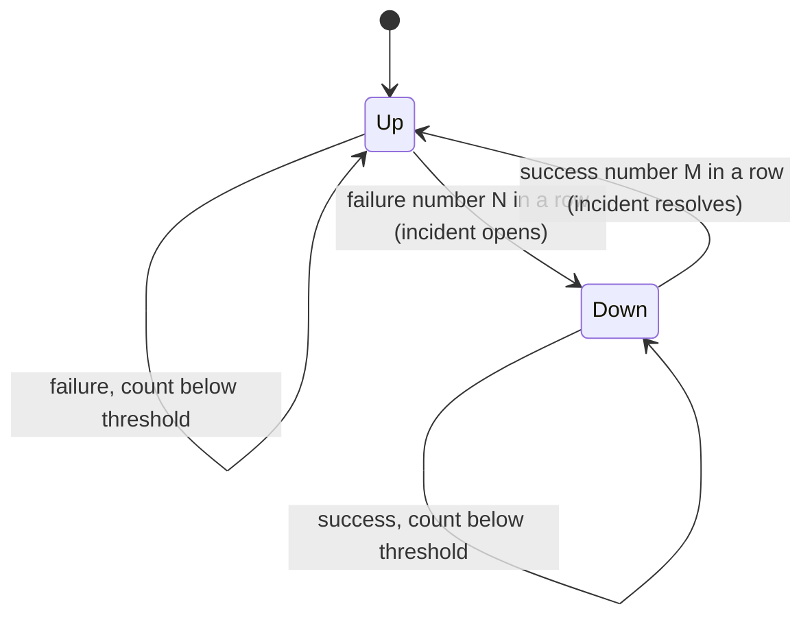

# uptime-lite

Self-hosted uptime monitor with debounced incident detection and a static public status page.

Site: [mohamedtaqysalmi.github.io/uptime-lite](https://mohamedtaqysalmi.github.io/uptime-lite/)

I built this for small deployments where one failed probe should not page me, but a real outage should open an incident, alert Telegram (or a webhook), and show up on a public HTML page I can host anywhere.

## Example

The [Pages site](https://mohamedtaqysalmi.github.io/uptime-lite/) embeds an example status page, generated by the real `status-page` command from made-up check results (`scripts/generate_example_status.py`). A terminal recording is tracked in [issue 10](https://github.com/mohamedtaqysalmi/uptime-lite/issues/10).

## Quickstart

Requires Python 3.11 or newer.

```bash
python -m venv .venv
.venv/Scripts/activate        # Windows; on Linux/macOS: source .venv/bin/activate
pip install -e ".[dev]"
copy examples\config.example.yaml config.yaml   # or: cp examples/config.example.yaml config.yaml
```

Run every check once and write a status page:

```bash
uptime-lite check -c config.yaml -d uptime.db --no-alerts
uptime-lite status-page -c config.yaml -d uptime.db -o status
```

`check` exits with 1 if any check failed in that run, 2 if the config is invalid, and 0 otherwise. The example config targets `example.com` and documentation addresses, so some of its checks will fail until you point them at something you own.

Set `TELEGRAM_BOT_TOKEN` (and optionally `WEBHOOK_BEARER_TOKEN`) before dropping `--no-alerts`. Tokens never go in YAML.

## Configuration

Checks are defined in YAML and validated up front. Every problem found is reported at once and names the check and the field.

| Field | Required | Default | Notes |
| --- | --- | --- | --- |
| `checks[].name` | yes | — | Unique |
| `checks[].type` | yes | — | `http` or `tcp` |
| `checks[].target` | yes | — | URL or `host:port` |
| `checks[].interval` | no | 60 | Seconds. Validated but not used yet: there is no scheduler, so run `check` from cron or Task Scheduler |
| `checks[].timeout` | no | 10 | Must not exceed `interval` |
| `checks[].failure_threshold` | no | 3 | Consecutive failures to open |
| `checks[].recovery_threshold` | no | 2 | Consecutive successes to resolve |
| `checks[].expected_status` | no | any 2xx | HTTP only. 3xx codes are rejected because redirects are followed |
| `alerts.telegram.chat_id` | no | — | Token from `TELEGRAM_BOT_TOKEN` |
| `alerts.webhook.url` | no | — | Optional bearer from `WEBHOOK_BEARER_TOKEN` |
| `status_page.title` | no | `Status` | Used in generated HTML |

Full example: [examples/config.example.yaml](examples/config.example.yaml).

## How the debounce works

A single failed request is usually noise, so a check does not go down on the first failure. It goes down after `failure_threshold` failures in a row and comes back after `recovery_threshold` successes in a row. A result of the opposite kind resets the streak.



Logic lives in [src/uptime_lite/incidents.py](src/uptime_lite/incidents.py). State is stored in SQLite so a restart continues the current streak.

## Alerts

On `opened` / `resolved` transitions, `uptime-lite check` can notify:

- Telegram `sendMessage` using `TELEGRAM_BOT_TOKEN` and `alerts.telegram.chat_id`
- A JSON webhook POST (`incident.opened` / `incident.resolved`)

Delivery is attempted once. A failure is logged (the exception type only, never the URL, which contains the Telegram token) and the run carries on. There is no retry, so an alert that fails to send is not sent later ([issue 9](https://github.com/mohamedtaqysalmi/uptime-lite/issues/9)). Alerts are sent after the result is committed, so a crash in between also loses the alert ([issue 16](https://github.com/mohamedtaqysalmi/uptime-lite/issues/16)).

## Status page

```bash
uptime-lite status-page -c config.yaml -d uptime.db -o status
```

Writes `status/index.html` from current check state and recent incidents. Publish that folder (or regenerate into your Pages tree).

## Resource usage

One `uptime-lite check` run with 20 checks (10 HTTP, 10 TCP) against a loopback server, measured on 2026-11-12 on an Intel i5-10210U laptop with 23.8 GB RAM, Windows 11, Python 3.15.2: median peak memory 33.4 MiB (an idle interpreter is 23.8 MiB), median CPU 1.16 s including interpreter start-up, 1.6 s wall time for the whole process. Loopback means no real network latency. Linux and long-running use are not measured. Method and caveats: [docs/resource-usage.md](docs/resource-usage.md).

## Testing

```bash
pytest
ruff check .
ruff format --check .
mypy
```

Coverage must stay at or above 85%. See [QA.md](QA.md) and [TEST_REPORT.md](TEST_REPORT.md).

## Security notes

- Do not put bot tokens or webhook bearer tokens in YAML or the repo.
- Status pages are public by design; do not put internal hostnames you care about hiding.
- Private vulnerability reports: [SECURITY.md](SECURITY.md).

## Limitations

- No built-in interval scheduler yet; drive `check` from cron or Task Scheduler.
- Checks in one run execute one after another. A target that hangs holds up the rest for up to its timeout, and the timeout does not cover DNS resolution, so a slow resolver can exceed it ([issue 15](https://github.com/mohamedtaqysalmi/uptime-lite/issues/15)).
- If the system clock moves backwards, results timestamped before the last applied one are stored but ignored by the state machine until time catches up ([issue 17](https://github.com/mohamedtaqysalmi/uptime-lite/issues/17)).
- Results are never pruned ([issue 13](https://github.com/mohamedtaqysalmi/uptime-lite/issues/13)).
- Single-node SQLite only.
- Pages demo status is a snapshot, not a live monitor feed.

## Roadmap

Tracked as GitHub issues under milestone v0.2.0 (scheduler loop, Docker image, richer status history).

## Contributing

See [CONTRIBUTING.md](CONTRIBUTING.md).

## License

MIT, see [LICENSE](LICENSE).
