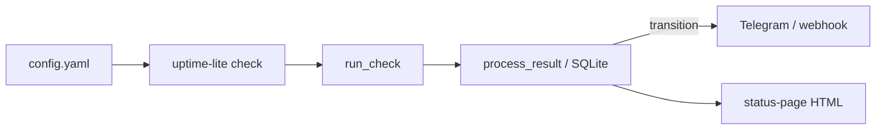

# Architecture

Short decisions for v0.1.0. Each ADR is one choice and what it costs.

## ADR-001: Debounce in a pure function, persist after

**Decision.** Incident open/resolve lives in `incidents.evaluate`, which takes the result's timestamp as an argument and never reads a clock. `monitor.process_result` wraps it in one SQLite transaction with the result row and check state.

**Why.** The flapping logic is the hard part; keeping it free of I/O makes it easy to test with a fake clock and out-of-order timestamps.

**Trade-off.** Callers must remember to pass timezone-aware times. A crash mid-transaction rolls back, so you never see an open incident without matching state — but you also lose that one result until the next check.

## ADR-002: Secrets stay in the environment

**Decision.** YAML may name a Telegram `chat_id` and a webhook URL. Tokens (`TELEGRAM_BOT_TOKEN`, optional `WEBHOOK_BEARER_TOKEN`) are read at send time from the environment. Putting a token in YAML is a config error.

**Why.** Config files get committed; env vars do not (when the operator is careful).

**Trade-off.** Local demos need a `.env` or shell export. There is no secrets manager integration in v0.1.0.

## ADR-003: Static status page, not a live app

**Decision.** `uptime-lite status-page` writes `index.html` from SQLite. The GitHub Pages site ships an example snapshot plus project docs; operators regenerate after checks.

**Why.** No public write surface, cheap hosting, and the page still works if the monitor process is down.

**Trade-off.** Freshness depends on how often you regenerate and publish. There is no websocket live view.

## ADR-004: Stdlib HTTP client for checks and alerts

**Decision.** Checks and alert posts use `urllib` / `socket`. Transports are injectable for tests.

**Why.** One dependency today (PyYAML). Installs stay small.

**Trade-off.** No connection pooling, no HTTP/2, no fancy retry policy. Timeouts are socket timeouts, not a wall-clock limit: they apply per operation and do not cover DNS resolution.

## ADR-005: One-shot CLI first, interval scheduler later

**Decision.** v0.1.0 ships `check` (run every target once) and `status-page`. A long-running interval loop is deferred.

**Why.** The state machine, storage and alerts are testable without a scheduler. Cron or Task Scheduler can already call `check`.

**Trade-off.** Multi-interval fairness, jitter and graceful shutdown are not implemented yet.

## Data flow

